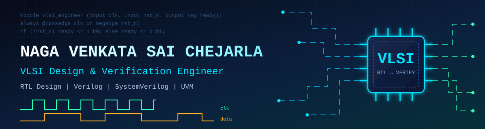
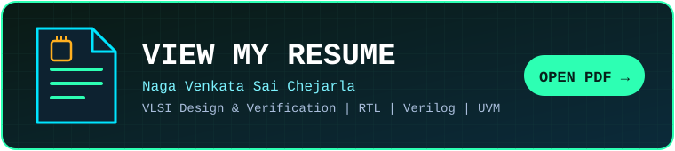

 

 

  

---

## 👨‍💻 About Me

I'm an **Electronics and Communication Engineering graduate (B.Tech, 2026)** from **St. Ann's College of Engineering and Technology, Chirala**, with a strong foundation in **digital electronics, CMOS design, and Verilog/VHDL**.

- 🔬 Hands-on experience in **RTL coding, functional simulation, testbench development, and waveform-based timing verification** using **ModelSim, QuestaSim, and Xilinx tools**
- 🏢 Completed a **VLSI Signal Processing internship** at Shri Shasha Prayathi Technologies Pvt. Ltd.
- 🎓 Currently doing **Design Verification training at VLSI Guru Institute** (RTL simulation & verification flow on Linux)
- 🌱 Currently learning **SystemVerilog** and **Verification Methodology Fundamentals (UVM)**
- 🎯 Seeking an **entry-level Design Verification / RTL Design** role
- 📍 Based in **Bapatla, Andhra Pradesh, India**

---

## 📄 Resume

 

| Focus | Details |
|---|---|
| 🎯 Target role | Entry-level Design Verification / RTL Design Engineer |
| 🏢 Experience | VLSI Signal Processing Intern, Shri Shasha Prayathi Technologies Pvt. Ltd. |
| 🎓 Training | Design Verification, VLSI Guru Institute (ongoing) |
| 🧪 Tools | ModelSim, QuestaSim, Xilinx Vivado and ISE, Linux, GVim |

---

## 🛠️ Technical Toolkit

### 💻 HDLs & Programming

### 🧪 EDA & Simulation Tools

### 🖥️ Platforms & Editors

### 🧠 VLSI & Design Concepts

### 🔌 Hardware & Embedded

### 🤝 Soft Skills

---

## 🚀 Featured Projects

| # | Project | Tools | Highlights |
|---|---------|-------|-----------|
| 1 | **Hierarchical Full-Adder-Based 16-bit Ripple Carry Adder** | `Logisim` | Cascaded full adders at gate level; verified sum and carry outputs across test input combinations |
| 2 | **Optimization of 4-bit Ladner-Fischer Parallel Prefix Adder for Low-Power VLSI** | `DSCH 3.5` `Microwind` | Schematic-level design with a prefix network optimized for reduced logic depth and power; CMOS layout with timing and power analysis |
| 3 | **FSM-Based Traffic Light Controller (Dual-HDL)** | `Verilog` `VHDL` `Vivado` | Timer-based FSM modeled in both Verilog and VHDL; state sequencing verified with testbench waveforms |
| 4 | **Design & Functional Verification of an 8-bit ALU** | `Verilog` `Xilinx ISE` | Arithmetic and logical operations, each verified with a self-written testbench and waveform analysis |
| 5 | **Synchronous FIFO Memory Design & Verification** 🔄 *Ongoing* | `Verilog` `ModelSim` `Linux` `GVim` | Parameterized FIFO with full/empty flag logic, verified with a testbench in ModelSim |
| 6 | **UART Transmitter & Receiver using FSM** 🔄 *Ongoing* | `Verilog` `ModelSim/QuestaSim` `Linux` `GVim` | FSM-based TX/RX modules; serial data transfer verified through waveform analysis |

---

## 📊 GitHub Stats

 

---

## 🏆 Achievements & Certifications

### 📜 Certifications
- ✅ **VLSI Design Workshop (3-Day)** — KALKI TECH
- ✅ **Spoken Tutorial Certification** — C, Python
- ✅ **PCB Designing**

### 🎖️ Achievements & Activities
- 🤝 **NSS Commando (2022 – 2026)** — active volunteer in National Service Scheme community service activities
- 🎤 Actively participated in **project expos and fest events**, including **paper presentations**

---

## 🎓 Education

| Qualification | Institution | Year | Score |
|---|---|---|---|
| B.Tech — Electronics & Communication Engineering | St. Ann's College of Engineering and Technology, Chirala | 2022 – 2026 | 71% |
| Intermediate (PMC) | Sri Vignani VGRM Junior College | 2020 – 2022 | 81% |

---

## 🤝 Let's Connect

I'm open to **entry-level Design Verification and RTL Design opportunities**. Feel free to reach out!

 

  

⭐ *Thanks for visiting my profile!* ⭐

